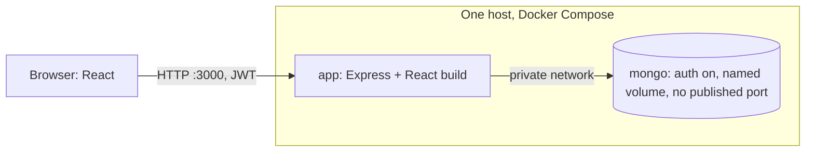

# Solution Design: Roster Checker

Deployed to EC2 with Docker Compose (commit a310f1d), verified there with 54 API-level checks; not yet clicked through in a browser. Every assumption is unconfirmed; the list is in `docs/ASSUMPTIONS.md`.

## 1. Problem
Managers publish rosters, and double-bookings surface only when someone fails to show. By then staff have planned around it. The checker reads the roster before it goes out and lists every conflict with the employee and shift IDs involved. It warns; it never blocks.

## 2. Key assumptions (risk if wrong)
- Double-booked means any time overlap, at any store (they may also want back-to-back shifts at two stores flagged).
- Rosters arrive as three CSVs shaped like the seed (real exports differ).
- 11h minimum rest; only approved leave counts; one time zone, no overnight shifts.
- Names are dropped on read; only IDs are stored. Records expire after 30 days.
- One shared manager account; employees see the latest saved check (there is no publish step).

## 3. Scope
**In:** six rules with zero false positives on the seed (same-store and cross-store overlap, shift on leave, rest under 11h, duplicate rows, bad or unknown rows). Manager and employee login. Saved history. **Out:** roster generation, rostering-system integration, hours rules, password reset, AI.

## 4. Architecture

Express holds auth, routes, the parser and the rules. The rules never touch the database. Overlap detection sorts each person's shifts, drops active shifts that end at or before the next start (touching is not overlap), and pairs the rest. That finds nested and three-way overlaps in O(n log n + k) and stops at 1000 findings with a visible flag.

**Data:** `users` (bcrypt hash), `rosters` (rows that passed validation, no names), `validationresults`, `findings` (one document each, ordered). A save writes roster, findings, then the result last, with cleanup on failure. MongoDB here has no transactions, so none are used.

| Endpoint | Who | Purpose |
|---|---|---|
| `POST /api/auth/login`, `/logout`, `GET /me` | all | JWT sign-in |
| `POST /api/check` | manager | check and save a roster |
| `GET/DELETE /api/history[/:id]` | manager | paginated list, open, delete |
| `GET /api/me/schedule` | employee | own shifts, leave, findings only |
| `GET /health` | all | process alive (not the database) |

## 5. Decisions and trade-offs
- **JWT with a database check on every request.** Roles and account state are enforced on the server and take effect at once (deactivate an account and its token stops). Cost: **fail closed**: if MongoDB is down, login and checking return 503. That is deliberate. Only a failed save, after the account was verified, gives findings with `saved: false`.
- **MongoDB in a container on the same host, not Atlas.** No account, no outside call, no public port. Cost: one disk, manual backups, no failover.
- **Plain rules, no AI.** Deterministic and explainable.
- **Hand-written CSV parser.** No dependency; quoted commas are unsupported.
- **Plain HTTP.** No domain or certificate work, but tokens and data are unencrypted.
- **Build vs buy.** I have not checked their rostering tool. If it has these checks, use them. I'd build because rules like 11h rest and cross-store clashes are chain-specific and must run just before publishing.

## 6. Security and privacy
- bcrypt hashes only; JWT HS256 with a 32+ character secret, 8h expiry; token in browser memory only; roles checked server-side; employee identity comes from the token, never the request.
- Secrets live in `.env` (git-ignored), reach the app only as listed variables, and did not appear in a scan of container logs. MongoDB credentials are URL-encoded by the app.
- MongoDB sits on an internal Docker network with no published port. Size limits and strict validation on input; findings render as text.
- **Limits:** HTTP only, public demo passwords, no login rate limiting, in-memory logout list, the app uses the MongoDB root user.

## 7. Testing
286 automated tests (Jest, Supertest, an in-memory MongoDB): every rule including nested, three-way, touching and exactly 11h; the seed gives exactly the six findings; auth, roles, employee isolation, fail closed; persistence, pagination, delete, partial failures; Compose security properties. Verified by hand against the real Compose stack: both logins, history, restarts, outage, backup and restore. UI behaviour is covered by rendering tests only; the browser checklist in `docs/DEMO.md` is **not yet run**.

## 8. Operability
JSON logs without names, secrets or request bodies; health checks on both containers; `restart: unless-stopped` (not after a manual `docker kill`); clear error messages. Manual `mongodump` backup and restore, tested locally. Changing MongoDB credentials in `.env` does not change an existing database user.

## 9. 10x volume
Checks stay fast (unmeasured). Limits: one Node process, the 1 MB request cap, one MongoDB node. Next: per-store checks, a worker, a managed database with replication.

## 10. Remaining limits
Deployed to EC2 (a310f1d); no CI; touching shifts raise a short-rest finding (to confirm); no real TTL-expiry observation; the live site has not been clicked through in a browser.
