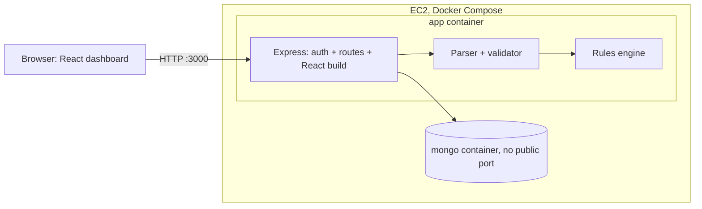

# Solution Design: Roster Checker

**Status: design only. Nothing is built or tested yet.** Every assumption below is unconfirmed. Detail is in `docs/ARCHITECTURE_FULL.md`.

## 1. Problem in my words
Managers publish rosters, and double-bookings surface only when someone fails to show or turns up twice. By then staff have planned around it and the shop is short. I'd build a checker that reads the roster before it goes out and lists every conflict with the people and shifts involved.

## 2. Assumptions (top 7, with risk)
- "Double-booked" means any time overlap, at any store. *Risk: they also want back-to-back shifts at two stores flagged.*
- The roster arrives as three CSVs shaped like the seed. *Risk: real exports differ.*
- The tool warns and never blocks. *Risk: they expect a hard stop.*
- At least 11h rest between shifts. *Risk: policy or law differs.*
- Only approved leave counts. *Risk: pending leave is missed.*
- One time zone, no overnight shifts. *Risk: night stores are mis-checked.*
- IDs are enough, names are dropped. *Risk: users want names shown.*

## 3. Requirements and scope
**In (first build):** detect the six seed problems with zero false positives: same-store overlap, cross-store overlap, shift on approved leave, rest under 11h, exact duplicate rows, malformed or unknown-reference rows. A React dashboard with a sample-data button, red or green banner, severity badges, findings table and History list. MongoDB saving of results. A shared access key, an Express REST API, deployment on one EC2 instance.
**Should:** GitHub Actions tests, delete route, filters, fix hints.
**Last, optional:** AI that only rewords existing findings (off by default, IDs, times and rule names only, 10s timeout, template fallback).
**Out:** roster generation, rostering-system integration, hours and overtime rules, accounts, versioning.

## 4. Architecture

**Overlap (3 lines):** sort each person's shifts by start. For each shift, drop active shifts ending at or before its start (touching is not overlap), then pair it with every shift still active. This finds every pair, including nested and three-way, in O(n log n + k), stopping at 1000 findings with a visible flag.

| Method | Endpoint | Purpose |
|---|---|---|
| GET | `/health` | Process and database state |
| POST | `/api/check` | Check and save one roster (CSV text in JSON) |
| GET | `/api/results` | List saved results |
| GET | `/api/results/:id` | Open one result |
| GET | `/` | The React app |

Errors: 400, 401, 404, 413, 500, and 503 for history only.

## 5. Key decisions and trade-offs
- **MongoDB built last:** it is milestone 4, so a late finish costs history, not the checker.
- **Plain rules, no AI:** results are deterministic and explainable.
- **Hand-written CSV parser:** no dependency, but quoted commas are unsupported.
- **Sweep-line, not neighbour comparison:** neighbours miss nested overlaps.
- **Plain HTTP:** no domain or certificate work, but unencrypted.
- **Build vs buy:** I haven't checked what their rostering tool already does. If it has these checks, switch them on. I'd build because the rules (11h rest, cross-store clashes) are chain-specific and must run just before publishing. "Quicker" is my estimate, not measured.

## 6. Security and privacy
- **HTTP only:** the key and roster data are not encrypted. Use fictional data and a temporary key only, and change it after judging.
- The key is typed by the user, kept in memory only, sent as `Authorization: Bearer`, compared in constant time, never logged or returned.
- Names are dropped on read, never stored or logged. Stored IDs expire after 30 days (assumption).
- Input size limit and strict validation. Only port 3000 is open, plus SSH from my IP. MongoDB has no public port. Secrets live in `.env`, not git.

## 7. Testing approach
Jest and Supertest: parsing, each rule (nested, three-way, touching, exactly 11h), the seed files giving exactly six findings, API and key checks, and database tests against a real MongoDB. GitHub Actions comes later. The dashboard and deployment are checked by hand. There are no UI tests.

## 8. Operability
`GET /health` (with database state), JSON logs without names, `restart: unless-stopped`, clear error messages. If the database is down, checks still return findings with `saved: false`.

## 9. Scaling: 10x volume
The check should stay fast (O(n log n + k), unmeasured). Limits: one Node process, request size, one database node. Next: check one store at a time, a worker, a managed database.

## 10. Limits and next steps
**Build order, 150 minutes, no spare buffer:** (1) rules and `POST /api/check`, tested locally without a database, 63; (2) dashboard with sample-data button, 33; (3) deploy with the `app` service only and check the live URL, 18; (4) MongoDB: models, saving, history, `mongo` service, database tests, redeploy, 36. If time runs out before 4, the app still works with `saved: false` and History marked unavailable.
**Limits:** touching shifts raise a short-rest finding (to confirm). One shared key, no backups, unencrypted HTTP.
