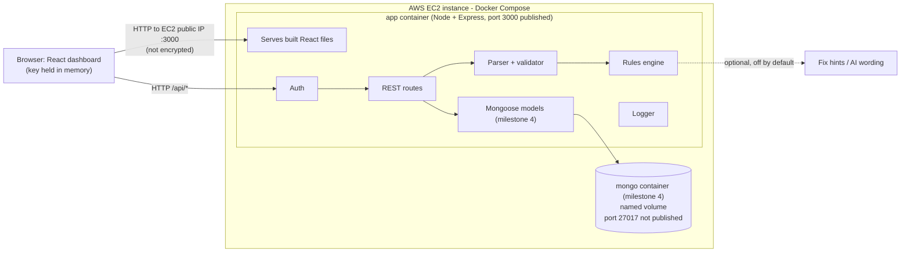

# Solution Design: Roster Checker

**Case:** a grocery chain's Head of Store Operations: *"We keep finding out too late that someone was double-booked. We want something that checks a roster before it goes out. What would you build?"*
**Status:** design only. Nothing is built yet. Names such as file paths are proposed. Every assumption is **unconfirmed** and is listed in `docs/ASSUMPTIONS.md`.

> **Temporary hackathon demo, HTTP only.** The deployed app is reached over plain HTTP at the EC2 public IP. Traffic, including the access key and the roster data, is **not encrypted**. It must only be used with **fictional roster data and a temporary access key**, and must never be used with real staff data. See sections 12, 13 and 18.

> **Delivery order (Decision 12).** MongoDB persistence is part of the first build, but it is built **last**, as milestone 4, after the checker, the dashboard and the first deploy. If time runs out before milestone 4, the deployed app still works with `saved: false` and the History list marked unavailable. Section 21 has the milestones and the 150-minute plan.

## 1. Problem statement and objectives

Roster mistakes, such as one person booked twice, are found after the roster is published, when fixing them is expensive and visible. The brief is deliberately incomplete, so this design states its assumptions instead of guessing silently.

**Objectives**
- Check a roster **before** it goes out and report every problem with the people and shifts involved.
- Find the six problems planted in the seed data and **nothing else** (zero false positives).
- Never crash on bad input. Report bad rows and carry on.
- Show the result clearly: a red or green banner, severity badges and a readable findings table.
- Keep earlier results so they can be reopened.
- Work with no AI and no third-party API.

## 2. Proposed solution and scope

A web dashboard where a manager enters a shared key, loads three CSV files (employees, shifts, leave), or clicks one button to load the sample data, and sees the findings. A deterministic rules engine does the checking.

**Stack (fixed):** React + Vite, Node.js + Express, MongoDB with Mongoose, Docker and Docker Compose, AWS EC2. MongoDB persistence is milestone 4 of the build order.

**In scope (Must, first build):** the six rule checks, input validation, the REST API, the presentable dashboard with the sample-data button, the access key, MongoDB saving and the History list, deployment to EC2, critical automated tests.
**After the Musts (Should):** a GitHub Actions workflow that runs the tests on every push, deleting a saved result, dashboard filters and download, fix hints. **Could:** configurable rest hours, and last of all an AI explanation (section 8).
**Out of scope:** roster generation, rostering-system integration, notifications, hours and overtime rules, overnight shifts, user accounts, roster versioning, encrypted transport (section 18).

## 3. Functional requirements

Full list with sources and traceability: `docs/REQUIREMENTS.md`.

| Priority | Requirements |
|---|---|
| **Must** | FR-01 `POST /api/check` (checks, saves, returns). FR-02 hand-written CSV parsing and row validation. FR-03 bad date or time reported. FR-04 exact duplicates reported once. FR-05 same-store overlap, every pair including nested. FR-06 cross-store overlap. FR-07 touching shifts are not an overlap. FR-08 shift on approved leave. FR-09 under 11h rest (exactly 11h is allowed). FR-10 finding fields. FR-11 summary. FR-12 unknown references reported. FR-13 access key required. FR-14 React dashboard: red or green banner, severity badges, findings table. **FR-21 sample-data button.** **FR-23 save a check, FR-24 list saved results, FR-25 open a saved result, FR-27 History list.** |
| **Should** | **NFR-R11 GitHub Actions workflow.** FR-15 fix hints. FR-16 seed data gives exactly the six problems. FR-17 row-order independence. FR-18 filters. FR-19 JSON download. FR-26 delete a saved result. |
| **Could** | FR-20 optional AI explanation. FR-22 configurable rest hours and leave statuses. |

**The core pipeline does not depend on any Should or Could item.** FR-16 and FR-17 are Should, but their checks sit inside the test step because they verify the Must rules.

## 4. Non-functional requirements

| Area | Requirements |
|---|---|
| Security | Key compared in constant time, never logged or returned. No secrets in code, frontend source or build. Key held in browser memory only. Size limit and strict validation. **Transport is unencrypted HTTP (temporary demo, fictional data only).** Database credentials only on the server, and the MongoDB port not reachable from outside. |
| Privacy | No names logged, and none stored. Only IDs, stores, dates, times and findings are stored, and they expire after `RETENTION_DAYS` (assumption: 30). |
| Performance | About 150 shifts checked in under 2 seconds (a target, not yet measured). Overlap check O(n log n + k). |
| Reliability | Bad input never crashes the server. Structured logs, `GET /health`, the container restarts. A database failure doesn't stop a check from returning its findings, and saved results survive a restart. |
| Testing | Automated tests for the critical requirements (section 15), and a GitHub Actions workflow that runs them on every push (Should). Everything else is a manual check with a reason. |

## 5. System architecture

One application container serves the production React build and the API. Only the app port is exposed through the EC2 security group. MongoDB is a separate container, reachable only from the app container on the Compose network. Milestones 1 to 3 run without it (section 21).

## 6. Frontend design

React + Vite, one page, no router, built when the image is built and served by Express. State is in memory only (`useState`). The dashboard is built to look presentable in a demo, with these three things getting real time: a red or green banner, severity badges and a readable table.

| Piece | Responsibility |
|---|---|
| Key box | Password field. The key stays in React state, so a reload asks again. A 401 clears it. |
| File pickers and **sample-data button** | Read three CSV files with `FileReader`, or load the three seed files in one click (FR-21). |
| Check button | Sends `POST /api/check` with `Authorization: Bearer <key>`. |
| **Summary banner** | **Green** when `clear` is true, **red** when there are findings. Shows the counts per rule, rows skipped and the truncation notice. |
| **Findings table** | One row per finding: severity badge (error or warning), rule name, employee ID, shift IDs and the message, in a readable layout. Plain text only. |
| History list (FR-27, milestone 4) | Calls `GET /api/results` and reopens one with `GET /api/results/:id`. Says "history unavailable" on a 503. |
| Notice | A one-line banner: "Demo over unencrypted HTTP. Use fictional data only." |

No `dangerouslySetInnerHTML`, no `localStorage`, `sessionStorage` or cookies. The key is never in the source or the build. Colour is never the only signal: the banner and badges also carry text ("Problems found", "Clear", "Error", "Warning").

## 7. Backend design

One Express process in small modules (proposed paths under `app/server/`):

| Module | Responsibility |
|---|---|
| `index.js` | App set-up, body limit, static files, routes, 404 and error handlers. |
| `config.js` | Reads environment variables. Refuses to start without `ACCESS_KEY`. |
| `auth.js` | Constant-time check of the `Bearer` key. |
| `logger.js` | One JSON line per request. No names, CSV or secrets. |
| `routes/check.js` | Runs a check and builds the response. |
| `parse/` | Hand-written CSV parser and row validation. Names are dropped here. |
| `rules/` | Pure functions: duplicate, overlap, rest, leave. No HTTP or database code. |
| *Milestone 4:* `db.js`, `models/`, `routes/results.js` | Mongoose connection with background retry, the `Roster`, `ValidationResult` and `Finding` schemas, and the list, open and (optional) delete routes. `routes/check.js` then also saves. Persistence is switched on only when `MONGODB_URI` is set, so milestones 1 to 3 run without it. |

## 8. Rules-engine design and algorithms

**Processing order:** parse and validate (names dropped) → remove exact duplicates → check employee and store references → run overlap, rest and leave on the remaining shifts → sort, number and summarise. Bad rows never reach the rules.

| Rule | What it reports |
|---|---|
| `DATA_BAD_ROW` | A row that can't be read: wrong field count, bad date or time, `end` not after `start`, bad ID, a reused `shift_id` with different content. Includes file and line. |
| `DUPLICATE_ROW` | A row identical to an earlier one in every field. Reported once and removed before the rules run. |
| `UNKNOWN_REF` | A shift or leave row naming an employee or store that isn't known. |
| `OVERLAP` | Two shifts for one person that overlap, at the same store or at two stores. |
| `SHORT_REST` | Under 11h between one shift's end and the next start. |
| `ON_LEAVE` | A shift on a day of approved leave (inclusive range). |

**Overlap: sweep-line with an active list**
1. Convert each shift once to start and end minutes (UTC arithmetic, no daylight-saving effects). Group by employee.
2. Process employees in ID order. Sort each person's shifts by `(start, end, shift_id)` using a plain character comparison, so order is the same on every machine.
3. Keep an `active` list. For each shift `s`: drop every active shift whose end is **at or before** `s.start` (this is why touching shifts don't overlap), report one `OVERLAP` for each remaining active shift, then add `s`.
4. Every remaining active shift started no later than `s` and ends after `s` starts, so it overlaps `s`. This reports **every overlapping pair**, including nested shifts and three-way overlaps. Comparing only neighbours would miss, for example, a 13:00–15:00 shift against a 09:00–17:00 shift when a 10:00–12:00 shift sits between them.
5. **Complexity:** sorting and grouping cost O(n log n). Each step scans the active list once, and each shift scanned is either removed (once per shift) or kept and reported as a pair. So the sweep costs O(n + k) and the total is **O(n log n + k)**, where k is the number of pairs reported. No heap is needed: pairing has to visit every active shift anyway, and that cost is paid by the output.
6. **Limit:** if everything overlaps, k reaches about n² / 2. Reporting stops at `MAX_FINDINGS` (assumption: 1000), the sweep stops, and the summary says `truncated: true`. Never silent.
7. **Deterministic:** fixed processing order, and findings sorted by employee, first shift start, rule and shift IDs, then numbered (`seq`). Same input, same output, every time.

**Rest:** after sorting, track the latest end seen. If it is after the next start, the shifts overlap and rest is skipped. Otherwise a gap under 11h is `SHORT_REST`. Cost O(n) after the sort. Consequence to confirm: touching shifts have a 0h gap, so they raise `SHORT_REST` even though they are not an overlap.
**Leave:** group approved leave per person and compare each shift's date with those ranges. Cost is shifts times that person's ranges, which is small (I make no O(n log n) claim here).

**Optional steps (never needed by the core):** fix hints (FR-15) are fixed text per rule in a separate `hint` field. The **AI explanation (FR-20)** is limited to rewriting the explanation text of findings that already exist. It is off by default (`AI_MODE=off`), sends only IDs, times and rule names (never names), has a 10-second timeout, falls back to the template text, and can never create, remove, modify or influence a finding. There is no chat, summary, prioritisation or recommendation function.

## 9. MongoDB data model (milestone 4)

This section describes persistence, which is a Must and is built last (milestone 4), after the checker, the dashboard and the first deploy. Until then no database is used and `saved` is `false`.

Three collections, Mongoose `strict` mode (unknown fields such as a name are dropped). No users collection.

| Collection | Fields |
|---|---|
| `rosters` | `createdAt`, `expiresAt`, `employees[]` (`employeeId`, `homeStore`), `shifts[]` (`shiftId`, `employeeId`, `storeId`, `date`, `start`, `end`), `leave[]` (`leaveId`, `employeeId`, `startDate`, `endDate`, `status`). Only rows that passed validation. No name, role or hours. |
| `validationresults` | `rosterId` → `rosters`, `createdAt`, `expiresAt`, `minRestHours`, `summary` (`clear`, `shiftsReceived`, `shiftsChecked`, `rowsSkipped`, `truncated`, `counts` per rule) |
| `findings` | `resultId` → `validationresults`, `seq`, `rule`, `severity`, `employeeId` or null, `shiftIds[]`, `message`, optional `hint`, optional `explanation`, optional `source` and `line`, `expiresAt` |

- **Relationships:** result → roster (one to one here), finding → result (many to one).
- **Indexes:** `findings (resultId, seq)`, `validationresults (createdAt desc)`, and a TTL index on `expiresAt` in all three.
- **Write order:** roster, then findings, then the result last, so a result never exists without its findings. A standalone MongoDB has no multi-document transactions. On failure the code tries to clean up, and TTL removes leftovers.
- **Retention (assumption, unconfirmed):** documents expire after `RETENTION_DAYS` (30). MongoDB's TTL process deletes them about a minute or two after expiry, not exactly at expiry.
- **Findings are separate documents** so a large result can't reach MongoDB's 16 MB document limit and can be read in order.

**Database configuration:** `MONGODB_URI` from the server environment, built by Compose from `MONGO_ROOT_USER` and `MONGO_ROOT_PASSWORD` (letters and digits only, so no URL encoding is needed), with the service name `mongo` as host. Connection settings (my assumptions, to check when coding): a short server-selection timeout of about 5 seconds, and `bufferCommands` off so a call fails fast when the database is down. The tests use the same variable with a separate database name.

**Deployment:** MongoDB runs as its own container on the same EC2 instance, with authentication on, data on the named volume `mongo_data`, and **no published port**. The data is disposable (30-day expiry, re-uploadable), so no backups are made.

**When the database is down (NFR-R9):** `POST /api/check` still returns its findings, with `saved: false`. The history routes return 503 `DB_UNAVAILABLE`. The app retries the connection in the background. Credentials and the connection string are never logged or returned.

**Hardening not planned for the first persistence build:** the app uses the MongoDB root user inside the private Compose network. A least-privilege user is an optional improvement.

## 10. API specification

All `/api` routes need `Authorization: Bearer <key>`.

| Method | Endpoint | Purpose | Request | Response |
|---|---|---|---|---|
| GET | `/health` | Process state. No key. | None | `200 {"status":"ok"}`. Once MongoDB is deployed it also has `"db":"up"\|"down"`. |
| POST | `/api/check` | Check one roster. | `{"employees":"<csv>","shifts":"<csv>","leave":"<csv>"}` (`leave` may be empty) | `200 {"resultId":"<id>"\|null,"saved":true\|false,"createdAt","summary","findings":[...]}`. `saved` is `false` if saving failed or MongoDB isn't deployed yet. |
| GET | `/api/results` | (FR-24) List saved results, newest first. `?limit=` default 20, maximum 50 (assumption). | None | `200 {"results":[{"resultId","createdAt","summary"}]}` |
| GET | `/api/results/:id` | (FR-25) One saved result with its findings in order. | None | `200 {"resultId","saved":true,"createdAt","summary","findings":[...]}` |
| DELETE | `/api/results/:id` | (Should, FR-26) Delete a result, its findings and its roster. | None | `204` |
| GET | `/` | The built React app. | None | `200` HTML, JS, CSS |

**Finding:** `rule`, `severity`, `employeeId`, `shiftIds`, `message`, plus `source` and `line` for data rows, and `hint` or `explanation` only if those optional steps are built. **Summary:** `clear`, `shiftsReceived`, `shiftsChecked`, `rowsSkipped`, `truncated`, `counts`.

**Errors** (body `{"error":{"code","message"}}`, plus `requestId` on 500):

| Status | Code | When |
|---|---|---|
| 400 | `INVALID_REQUEST` | Bad JSON, missing or non-string field, empty CSV, wrong header, malformed result ID. |
| 401 | `UNAUTHORIZED` | Key missing, wrong, or not sent as `Bearer`. |
| 404 | `NOT_FOUND` | Unknown route or method, or a result that doesn't exist or has expired. |
| 413 | `TOO_LARGE` | Body over `MAX_BODY_KB` (assumption: 1024). |
| 500 | `INTERNAL` | Unexpected error. Details only in the log. |
| 503 | `DB_UNAVAILABLE` | A history route was called while the database is down. `POST /api/check` never returns this. |

Order of checks: key, size, JSON and fields, headers, then the rules, so an anonymous caller learns nothing about validation.

## 11. End-to-end data flow

1. The user opens `http://<EC2 public IP>:3000`. Express serves the React build.
2. The user types the key, then picks three files or clicks the sample-data button. The browser holds the three CSV texts.
3. The browser sends `POST /api/check` to Express, with the key in the `Authorization` header.
4. Express checks the key and size, then parses and validates. Names are dropped.
5. The rules engine returns findings, and the summary is built.
6. Express saves the roster, findings and result to MongoDB over the private Compose network, then returns the response. If saving fails, or MongoDB isn't deployed yet, the response still arrives with `saved: false`.
7. The dashboard shows the red or green banner and the findings table, and adds the result to the History list. The history routes read it back from MongoDB later.

## 12. Security and privacy considerations

- **Transport is not encrypted (HTTP only).** The access key and roster data travel in clear text and could be read by anyone on the network path. This is acceptable only for a short-lived hackathon demo with **fictional data and a temporary key** that is not used anywhere else, and the key should be changed or the instance stopped afterwards. It is not suitable for real staff data, and I don't describe it as secure.
- **Names are never stored or logged.** They are read for validation and dropped. Stored IDs are pseudonymous but still personal data, so everything expires and a delete route is planned.
- **Network exposure:** the EC2 security group allows only the application port to the internet, plus SSH from your own IP. MongoDB's port stays closed and unpublished.
- **Database:** authentication on, credentials in server environment variables only, never in the React build, responses or logs. No request value is placed in a query, and result IDs are checked before use.
- **Input:** size limit, strict validation, uploaded text treated as untrusted, findings rendered as text.
- **No outside calls** from the app, and a short dependency list.
- **Not covered:** encrypted transport, user accounts, key rotation, brute-force limits, backups, encryption at rest.

## 13. Authentication and access-key handling

One shared key (Decision 2). The server reads `ACCESS_KEY` from its environment and refuses to start without it. The user types the key into the dashboard. It lives only in React state, so a reload asks again, and it is never in the source, the build, browser storage or the URL. Each request sends `Authorization: Bearer <key>`. The server compares SHA-256 hashes of the sent and expected values with a constant-time comparison. The key is never logged and never returned, including in error bodies.

Because the demo is on unencrypted HTTP, the key is visible on the network. So it must be a **temporary, throwaway value**, long and random, not reused for anything else. This is a demo-level gate, not user authentication.

## 14. Error handling and recovery

- Bad input gives a 400 that says what to fix. Bad **rows** are findings inside a 200, so the check still helps.
- One central handler returns a generic 500 with a `requestId`. Stack traces go to the log only.
- **App crash:** Docker restarts the container. **Host reboot:** the container restarts (`unless-stopped`, Docker enabled at boot).
- **AI or hint step failing:** findings are unchanged and the template text is used.
- **Public IP changes:** if the instance is stopped and started, its public IP changes and the URL stops working. Don't stop the instance during judging. An Elastic IP would fix this and is optional.
- **Database problems:** checks still return findings with `saved: false`, history returns 503, and the app reconnects by itself. A partial save is cleaned up, and TTL removes leftovers. A result is written last, so it is never visible without its findings.
- **Not covered:** disk-full alerts, failover, automatic backups.

## 15. Testing and verification strategy

Jest and Supertest, run before every commit. With 150 minutes there is time for the critical tests only, written together with each module.

**Critical tests (inside the 150 minutes):** 10 minutes in milestone 1, and 7 in milestone 4.

| Test file | Covers | Milestone |
|---|---|---|
| `parse.test.js` | Headers, field counts, bad dates and times, unknown references, names dropped. | 1 |
| `rules.test.js` | Each rule. Overlap: seed pair, nested, three-way, touching (must not overlap), cross-store, the `MAX_FINDINGS` cut-off. Rest at exactly 11h (allowed) and 10h59m (flagged). | 1 |
| `seed.test.js` | The real seed files give **exactly the six planted problems and nothing else**. | 1 |
| `api.test.js` | 200, the main 400 cases, 401 for a missing, wrong or wrong-scheme key, and the key never appearing in a 401 or 500 body. | 1 |
| `db.test.js` | Save and read back with the same findings in the same order, no names, roles or hours stored, TTL index and `expiresAt` set, bad and unknown IDs, and an unreachable database (check still returns findings with `saved: false`, history gives 503, no URI or password anywhere). Runs against a real MongoDB (a Compose `mongo` service and a separate test database). | 4 |

**Not in the 150 minutes (Should):** the GitHub Actions workflow (NFR-R11), `.github/workflows/test.yml`, which installs dependencies and runs the tests on every push and needs a MongoDB service for `db.test.js`. The separate `security.test.js` source scan (no browser storage, no `dangerouslySetInnerHTML`, no build-time key) and logging, config and timing tests are also cut from the 150, and tests for hints and the AI step if those are built. Until then the source scan is a manual grep in `/final`, and timing of about 150 shifts is measured by hand, so the 2-second target stays a target.

**Manual checks, with reasons** (a checklist in `docs/DEMO.md`): dashboard behaviour, including the sample-data button, banner, badges and History list (component tests would need extra dev dependencies and setup time), the deployed URL, restart behaviour, closed database port and data surviving a restart (need the real host), expiry actually deleting records (MongoDB's own process), and "no outside calls" (a test can't prove absence). There are no automated UI tests.

## 16. AWS deployment architecture

One EC2 instance running Docker Compose. The app is reached at `http://<EC2 public IP>:3000`.

- **Security group:** inbound TCP 3000 from anywhere (the application port, my assumption since evaluators' addresses are unknown), and SSH 22 **only from your own IP**. Port 27017 is never opened.
- **Instance size:** not chosen. I assume at least 2 GB of memory (Node, the Vite build and MongoDB) and 20 GB of disk, both unmeasured.
- **Public IP:** changes if the instance is stopped and started (section 14).
- **Pre-work outside the clock** (about 10 to 15 minutes): launch the instance, set the security group, install Docker and Docker Compose.

## 17. Docker and Docker Compose setup

**Milestone 3 (first deploy), app only:**

| Service | Image | Published ports | Storage | Notes |
|---|---|---|---|---|
| `app` | Built by us (multi-stage: Vite build, then a small runtime image running Node as a non-root user). Serves the React build and the API. | **3000** | None | Health check on `/health`. `env_file: .env`. `restart: unless-stopped`. |

**Milestone 4, one more service:**

| Service | Image | Published ports | Storage | Notes |
|---|---|---|---|---|
| `mongo` | Pinned official `mongo` image | **None** | Named volume `mongo_data` (data survives restarts) | Authentication on via the root user variables. Health check with `mongosh`. Reachable only from `app` on the Compose network. `restart: unless-stopped`. `app` then waits for it to be healthy, and still copes with a late database. |

The React client and the Express server are one image and one container.

## 18. Transport security: HTTP only for this demo

There is no encrypted transport in this design. This section exists so the limitation is stated plainly.

- The app is served over **plain HTTP**. The access key, the roster data and the findings are visible to anyone who can see the network path.
- **Rules for using the demo:** fictional roster data only (the seed files and the sample-data button), a temporary random access key used nowhere else, no real staff names or IDs, the instance stopped or the key changed after judging.
- The README and the dashboard banner say "Demo over unencrypted HTTP, fictional data only".
- **To use real data, encrypted transport would have to be added first.** That is a known gap and is listed under limitations, not hidden.

## 19. Environment variables and secrets management

| Variable | Default or example | Secret | When |
|---|---|---|---|
| `ACCESS_KEY` | long random temporary value | Yes | Milestone 1 |
| `PORT`, `MAX_BODY_KB`, `MAX_FINDINGS`, `MIN_REST_HOURS` | `3000`, `1024`, `1000`, `11` | No | Milestone 1 |
| `AI_MODE`, `AI_URL` | `off`, empty | No | Only if FR-20 is built |
| `MONGO_ROOT_USER`, `MONGO_ROOT_PASSWORD` | letters and digits only | Yes (password) | Milestone 4 |
| `MONGODB_URI` | built by Compose from the two above. Persistence is on only when this is set. | Yes | Milestone 4 |
| `RETENTION_DAYS` | `30` | No | Milestone 4 |

`.env.example` is committed with placeholders. `.env` lives only on the host and is in `.gitignore`. No secret is in the image, in build arguments or in the React build. The final check greps files and git history for secrets.

**Deployment steps (milestone 3, app only):**
1. On the instance, clone the repo and create `.env` with a temporary `ACCESS_KEY`.
2. `docker compose up -d --build`.
3. Open `http://<EC2 public IP>:3000/health` and expect `{"status":"ok"}`.
4. Open the dashboard, type the key, click the sample-data button and check that exactly the six planted problems appear in a red banner.
5. Put the URL and the "HTTP only, fictional data" notice in the README.

**Adding MongoDB (milestone 4):** add the `mongo` service and the Mongo variables, set `MONGODB_URI`, run `docker compose up -d --build`, check `/health` shows `"db":"up"`, run a check and see it appear in the History list after a reload.

## 20. Assumptions, constraints and limitations

**Assumptions (unconfirmed, detail in `docs/ASSUMPTIONS.md`):** "double-booked" means any time overlap at any store; the roster arrives as CSVs shaped like the seed data; the tool only warns and never blocks; at least 11h rest; only approved leave counts; names are not needed after validation; 30-day retention; one time zone and no overnight shifts; known stores are the distinct `home_store` values; `MAX_FINDINGS` of 1000, a 1 MB request limit and a history limit of 50; severities (duplicate is a warning, the rest are errors); port 3000 open to the internet.
**Constraints:** the fixed stack, a 150-minute build, and the AI limit above.
**Limitations:** unencrypted HTTP; **if milestone 4 isn't finished, the app returns `saved: false` and history is unavailable, and the saved-results requirement is not met**; quoted commas are not supported; touching shifts raise `SHORT_REST` (to confirm); a skipped bad row may hide a clash, so `clear` is true only when there are no findings at all; one shared key; no accounts; hours, overtime and cover are not checked.

## 21. Implementation plan with realistic time allocation

The implementation window is **150 minutes**. The plan below totals exactly 150.

**Build order (the way to protect the deadline).** Four milestones, in this order. Each one leaves a working app, and MongoDB is last on purpose:

1. **Milestone 1: rules and `POST /api/check`**, tested locally with no database.
2. **Milestone 2: React dashboard** with the sample-data button, red or green banner, severity badges and findings table.
3. **Milestone 3: deploy to EC2** with only the `app` service in Compose, and check the live URL.
4. **Milestone 4: add MongoDB:** Mongoose models, saving, the history routes, the `mongo` service in Compose, the History list and the database tests. Then redeploy.

**If time runs out before milestone 4,** the deployed app still works: `POST /api/check` returns its findings with `saved: false`, and the dashboard shows the History list as unavailable. Nothing before milestone 4 depends on the database.

**Time plan: 150 minutes, no spare buffer.** The protection is the order above: milestone 4 is last, so it is what shrinks or goes if earlier milestones overrun. The rules and their tests are not cut.

| Milestone | Step | Minutes |
|---|---|---|
| 1 | Scaffold, `GET /health`, structured logging, env config | 8 |
| 1 | CSV parsing and row validation | 12 |
| 1 | Rules: sweep-line overlap, rest, leave, duplicates | 25 |
| 1 | `POST /api/check`: key check, input limits, clear errors, summary | 8 |
| 1 | Critical tests: parse, rules (nested, 3-way, touching, 11h), seed answer key, API and key checks | 10 |
| 2 | React dashboard: key box, file pickers, **sample-data button**, red or green banner, severity badges, findings table (minimal styling) | 33 |
| 3 | Dockerfile, Compose (`app` only), deploy to EC2, live check | 18 |
| 4 | Mongoose models, saving, history routes, database failure handling, `mongo` service in Compose | 20 |
| 4 | History list in the dashboard | 5 |
| 4 | Database tests | 7 |
| 4 | Redeploy and live check | 4 |
| | **Total** | **150** |

**Where the time came from.** Compared with an earlier draft that kept MongoDB outside the 150 minutes and had a 15-minute buffer, persistence, its tests, the History list and the redeploy add 36 minutes. They were paid for by dashboard polish (12 down to 3), non-critical tests (18 down to 10, so the separate key-leak scan test and extra error-case tests are manual or later), small trims to the API step (10 to 8) and the first deploy (20 to 18), and the whole buffer (15).

**Risks.** There is no buffer, and the estimates for the rules (25), the dashboard (33) and the database work (20) are tight. The first Docker build on the instance can be slow. If milestone 1 or 2 overruns, milestone 4 absorbs it.

**After the Musts, in this order (not in the 150 minutes):** the GitHub Actions workflow (Should, about 10 minutes, my estimate), the delete route and dashboard filters and download (Should), fix hints, configurable rest hours, a least-privilege MongoDB user, and the AI explanation last.

## 22. Success criteria and evaluator demonstration plan

**Success criteria**
- The seed data produces exactly the six planted problems and no false positives (`seed.test.js` passes).
- Bad rows and unknown references are reported, and nothing crashes.
- Same-store and cross-store overlaps, leave conflicts, rest under 11h and exact duplicates are all detected, with nested and three-way overlaps covered by tests.
- The dashboard loads the sample data in one click and shows a red banner, severity badges and a readable findings table. A clear roster shows green.
- A saved result can be listed and reopened with the same findings, and no names are stored.
- The database port is not reachable from outside, and a check still returns findings when the database is down.
- The app works with `AI_MODE=off`, and the AI step is optional.
- The app is live at `http://<EC2 public IP>:3000`, and the README states that it is unencrypted and for fictional data only.
- The critical tests pass, and no secrets are in the files or git history.
- If milestone 4 is not reached: the live app works with `saved: false` and the History list marked unavailable, and this is stated in the README.

**Demonstration plan (about 5 minutes)**
1. Open the URL. Point out the banner: unencrypted HTTP, fictional data, temporary key.
2. Type the key and click the sample-data button. Run the check. Show the red banner and the six findings, and match each to `case/seed/README.md`. Point out that the 155 other shifts produce nothing.
3. Show a tricky input (a nested shift and a touching pair) and explain why the result is right. Load a clean roster to show the green banner.
4. Reload the page: the key is asked for again.
5. Show the test run and the Compose file with only port 3000 published.
6. Open the earlier result from the History list, show the stored MongoDB documents (IDs only, no names), then stop the database container and run a check, which still returns findings with `saved: false`.
7. Answer the panel: 10x volume, third-party APIs banned, and build versus buy (`docs/DECISIONS.md`).
